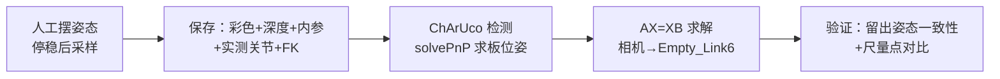

# d1t_vision：D1-T 眼在手上（eye-in-hand）视觉标定参考实现

本包是一份**开发参考**：RealSense 相机装在 D1-T 末端，把"相机看到的像素 + 深度"换算成机器人 `base_link` 坐标。
它记录了我们做到哪一步、测得什么数字、为什么没有继续扩大到全工作空间。**它不是已验收的视觉抓取方案**，仓库里也不附带任何可直接用的外参。

> 本文所有数字均为 2026-09 现场当时测得，换安装、换光照、换相机都需要自己重新测。

---

## 1. 目标与硬件

| 项目 | 配置 |
|---|---|
| 机械臂 | 宇树 D1-T；基座参考 `base_link`，相机安装参考 `Empty_Link6`（第六轴末端） |
| 相机 | Intel RealSense D435i，3D 打印支架刚性固定在夹爪舵机框架上，随手臂运动 |
| 图像 | 彩色 1280×720 @30fps；深度 848×480 @30fps，对齐到彩色像素网格 |
| 标定板 | ChArUco，`DICT_4X4_50`，5×5 方格，方格 30 mm、marker 22 mm，外边界 150×150 mm（设计文件见 `board_design/`） |
| 软件 | ROS2 Humble；OpenCV 4.5.4（含 aruco）；NumPy 1.21.5；realsense2_camera 4.58.3 / librealsense 2.58.3（当时版本） |

求解对象是 `camera_color_optical_frame → Empty_Link6` 这一个固定刚体变换，不是相机到夹爪中心，也不是机械臂本体的运动学标定。

## 2. 时间线

| 日期 | 做了什么 → 结果 → 为什么往下走 |
|---|---|
| 09-19 | 写离线求解、数据格式与测试 → 离线测试通过 → 去现场机补 ROS/OpenCV 环境 |
| 09-20 | 现场构建与相机联调 → colcon build/test 通过；30 秒四路图像各 899 帧、时间戳成对 → 数据链可用，开始制板 |
| 09-20 | 打印标定板 → 第一张实测 149.5×151.0 mm（横纵不等比）判废，重印合格后再用 → 开始采样 |
| 09-21～22 | 第一批 12 组标定 → 训练残差最大 7.51 mm，但 3 个新姿态看同一批点，最大分散 12.93 mm → 不接受全工作空间结果 |
| 09-22～23 | 尝试自动规划采样姿态 → 路径能跑完，但后续反馈检查失败、实际没采到样本 → 撤销自动路线，改回人工摆姿态采样 |
| 09-23～24 | 第二批 12 组人工标定 → 训练残差 RMS 3.623 mm，冻结为候选 → 用新姿态和尺量点验证 |
| 09-24 | 留出验证与新位置尺量 → 原板一致性 RMS 2.814 mm；但同一点换个姿态差 10 mm 左右 → 做离线诊断 |
| 09-24 | 离线诊断（覆盖范围、误差预算、五种求解算法对照） → 换算法不能消除构型相关偏差 → 改走"固定姿态拍照"受限路线 |
| 09-24 | 固定姿态测试起步：在位置 A 采 1 组（16 个角点全可见），规划了第一个对点路径（未执行） → 尺量对点闭环尚未完成 |

## 3. 方法（白话版）



1. **采样**：标定板固定不动，人工把机械臂摆到不同姿态，停稳后触发一次采集。保存彩色图、对齐深度、两份 `CameraInfo`、关节历史窗口、**实测**关节角（不用指令角代替）和对应 FK。时间不同步、数据过期、关节没停稳的样本直接拒收。
2. **求解**：每个姿态下，末端位姿 G 来自实测关节的 FK，板位姿 C 来自相机。板没动，所以存在一个固定的 X 使所有 `G·X·C` 都落在同一个位置——这就是手眼标定 `AX=XB`。实现用 Kronecker 积 + SVD 求旋转、最小二乘求平移；至少 8 组、推荐 12 组，不自动剔除离群样本。
3. **换算点**：取像素的**实测深度**（0 或超量程直接判无效，不插值补），按内参反投影到相机坐标，再经 X 和拍照时刻的 G 换到 `base_link`。

几个指标各回答不同的问题，不能互相替代：

| 指标 | 回答什么 |
|---|---|
| 重投影误差（px） | 板位姿投回图像与检测角点差多少像素，不是毫米精度 |
| 训练残差（mm） | 参与求解的姿态彼此是否一致 |
| 留出一致性（mm） | 没参与求解的新姿态看同一点，结果有多分散 |
| 尺量偏差（mm） | 视觉坐标与卷尺/卡尺量出的坐标差多少（受尺量本身误差影响） |

## 4. 关键数据（当时测得）

### 4.1 两批标定

| 数据 | 样本 | 结果 |
|---|---|---|
| 第一批训练 | 12 组，用 11 组 | 平均 3.91 mm / 0.81°，最大 7.51 mm / 1.31° |
| 第一批留出 | 3 个新姿态 × 15 个角点 | 一致性 RMS 8.83 mm，最大 12.93 mm |
| 第二批训练 | 12 组全用 | 位置 RMS 3.623 mm、最大 6.550 mm；方向 RMS 0.932°、最大 1.384° |
| 第二批留出（遮窗后） | 3 个新姿态 × 4 个角点 | RMS 2.814 mm，最大 3.719 mm |
| 固定姿态位置 A | 1 组，16 个角点 | 重投影 RMS 0.301 px，板区非零深度 99.65% |

第二批训练姿态的关节范围（URDF 角，度）：

| | J1 | J2 | J3 | J4 | J5 | J6 |
|---|---:|---:|---:|---:|---:|---:|
| 最小 | -95.3 | -29.5 | -36.5 | -42.5 | 71.1 | -137.8 |
| 最大 | 70.1 | 51.4 | 47.8 | 39.5 | 110.6 | 161.7 |

### 4.2 新位置尺量点

| 测试 | 结果 |
|---|---|
| ID10，1 个姿态 | XY 偏差 5.151 mm |
| ID4，1 个姿态 | XYZ 偏差 16.395 mm（该点难以量准） |
| ID15，两个不同构型 A / B | 与尺量值偏差 14.928 / 9.435 mm |
| ID15 的 A 与 B 互相比较（不依赖尺量） | 用深度算差 10.278 mm；纯 PnP 算差 11.271 mm，主要在 Z 方向 |

### 4.3 五种求解算法对照（同一批 12 组数据，OpenCV `calibrateHandEye`）

| 方法 | 与候选外参差（mm / °） | 原板一致性 RMS mm | ID10 XY mm | ID15 A / B mm |
|---|---:|---:|---:|---:|
| 本包求解（候选） | 0 / 0 | 2.814 | 5.151 | 14.928 / 9.435 |
| TSAI | 14.247 / 10.47 | 10.565 | 24.580 | 33.426 / 47.672 |
| PARK | 0.953 / 0.07 | 2.468 | 4.343 | 14.145 / 9.722 |
| HORAUD | 0.967 / 0.02 | 2.567 | 4.318 | 14.518 / 9.643 |
| ANDREFF | 26.459 / 0.01 | 13.016 | 17.226 | 17.815 / 17.408 |
| DANIILIDIS | 17.688 / 2.11 | 7.997 | 11.095 | 13.749 / 8.614 |

PARK、HORAUD 与本包结果接近；五种都没有消除 ID15 的偏差。结论：**换求解器解决不了这里的问题**。参考了 easy_handeye2 所用的这五种方法，但没有移植它的采样框架。

## 5. 为什么没有继续做全工作空间的 eye-in-hand

一句话：**同一个点换一个手臂姿态去看，结果会差 10 mm 左右；而夹爪夹 57 mm 瓶子时单侧余量只有 6.5 mm**（夹爪 raw 64.5 实测开口 70 mm）。要在全工作空间把误差压到余量以内，需要先查清偏差来源，投入与收益不成比例。

| 卡点 | 观察到的事实 | 当时的推测（未证实） |
|---|---|---|
| 构型相关偏差 | 同一点 ID15 换构型，深度法和纯 PnP 法都差约 10～11 mm；用保存的关节角重算 FK 与记录一致 | 可能来自舵机臂的零位/间隙/负载变形、支架、或手眼结果只在训练范围内有效；各项贡献没有量化 |
| 关节读数 | 反馈分辨率 0.1°；桥接时间戳是接收时间，不是编码器采样时间 | 分辨率不等于准确度，硬件级同步没有证据 |
| 深度受光照影响 | 遮窗前某板区非零深度仅 14.70%，遮窗后约 99.4% | 推测红外受窗外强光干扰，未取得红外图证实 |
| 并发订阅丢帧 | RViz 显示原图时 15 秒彩色/深度收到 63/0 帧，关掉后 450/450 | 关掉多余原图显示即可规避；根因未逐包追查 |
| 覆盖与参考不足 | 部分验证姿态超出训练关节范围；尺量参考自身误差没有独立测量 | 训练数据不足以证明所有构型可用 |

注意：这不是说 eye-in-hand 原理不行，也不是对 D1 或 RealSense 的评价，只是在本安装下"扩大到全工作空间"这条路暂停了。

## 6. 当前路线：固定姿态拍照，限定抓取朝向

- 选一个固定拍照姿态 P（放在训练关节范围内），只在实际抓取区域里用现有候选外参，不重新标定。
- "固定姿态抓取"指**抓取朝向固定**，不是 TCP 每次停在同一个 XYZ。
- 精度从夹爪倒推：单侧余量 6.5 mm，判据定为两指合拢方向尺量偏差 ≤ 4 mm，剩下 2.5 mm 留给识别等误差。精度在这个量级，用尺子量就够。
- 测试方法：TCP 走到标定板角点正上方，用尺量偏差；每个板位置至少 4 个角点，换 2～3 个板位置。

**进度**：位置 A 已采 1 组，第一个对点路径已规划（215 个路点、21.3 秒，**未执行**）。尺量对点结果、瓶子识别和真实夹取都还没有，所以**这条路线目前不能写成"固定姿态抓取已可用"**。

## 7. 包内代码

| 文件 | 作用 |
|---|---|
| `d1t_vision/geometry.py` | 矩阵、单位、`CameraInfo`、图像解码、深度反投影 |
| `d1t_vision/samples.py` | 样本格式、时间/关节校验、NPY + JSON 读写、SHA256 |
| `d1t_vision/board.py` | ChArUco 渲染与检测、solvePnP、重投影检查 |
| `d1t_vision/calibration.py` | AX=XB 求解、外参保存/加载、像素→base_link、留出验证 |
| `d1t_vision/runtime.py` | 配置校验、图像与关节配对选帧、TF 挂接检查 |
| `d1t_vision/cli.py` | 离线命令（`ros2 run d1t_vision vision_calibrate …`） |
| `d1t_vision/ros_nodes.py` | 三个 ROS 节点（见下） |
| `launch/vision_readonly.launch.py` | 按 `mode` 只启动一个节点，不启动相机和机械臂驱动 |
| `config/runtime.template.json` | 运行配置模板，所有现场字段留空，必须自己填 |
| `config/board-design.example.json` | 标定板设计值（`measured=false`） |
| `board_design/` | 可打印 PDF、PNG、生成脚本 `generate_board_pdf.py`（需 ReportLab）、打印检查方法和一次失败打印的记录 |

ROS 节点：

| 可执行文件 | 做什么 | 会不会动机械臂 |
|---|---|---|
| `vision_capture` | 订阅彩色/深度/内参/`joint_states`，调用 MoveIt `GetPositionFK` 服务；调用 `~/capture_sample`（Trigger）保存一组样本 | 不会；只读 + 写文件 |
| `vision_point_to_base` | 订阅 `~/camera_point`，发布 `~/base_point`（`base_link` 下的点） | 不会；发布消息 |
| `vision_camera_mount` | 可选：把外参作为静态 TF 发布 | 不会；发布 TF |

离线命令：

```bash
ros2 run d1t_vision vision_calibrate check-config <runtime.json>            # 严格校验运行配置
ros2 run d1t_vision vision_calibrate board <board.json> <out.png>           # 渲染标定板图案
ros2 run d1t_vision vision_calibrate detect <样本目录>                       # 对保存的彩色图重新检测
ros2 run d1t_vision vision_calibrate solve <数据集目录> <out.json> --max-translation-residual-m <米> --max-rotation-residual-rad <弧度>   # 阈值按自己的精度需求定
ros2 run d1t_vision vision_calibrate point <样本目录> <calibration.json> <u> <v>   # 像素 → base_link
ros2 run d1t_vision vision_calibrate check-held-out <数据集目录> <calibration.json> <out.json> --corner-ids 0 3 12 15
```

`solve` / `check-held-out` 按目录收集样本：一个目录只放同一次安装、同一个板位置的数据，不要混放。

依赖：`python3-opencv`（需含 aruco 模块）、`python3-numpy`；采集还需要 `realsense2_camera` 驱动和本仓库的 MoveIt（提供 FK 服务）。

## 8. 给后来者的建议（可以试的方向）

1. **证据分层**：图像能显示、板能识别、样本能保存、求解有输出、规划成功、物体夹起——是六件不同的事，逐层验证。
2. **先缩小范围**：只做一个台面区域时，先试固定拍照姿态 + 固定抓取朝向，按自己夹爪的余量定判据，再慢慢扩大。不要直接套用本文的外参、关节角或 4 mm 判据。
3. **标定板打印后一定要量**：横、纵分别量，再量多处方格；横纵不等比就重印，不要用 `print_scale` 掩盖。
4. **写清容易混的量**：控制器角与 URDF 角（本项目 J4/J6 反号）、度与弧度、光学 frame 与 `camera_link`、`Empty_Link6` 与 TCP、marker ID 与角点 ID。
5. **保留失败数据**：留出样本不进训练，不按验证结果反复筛训练集；深度 0 与 65535 如实记录，不插值。
6. **注意光照**：窗外强光可能让深度大面积失效，采样前先看深度图。
7. **偏差随构型变化时**，先设计同目标、不同接近方向的重复试验来定位来源，不要急着改外参或加固定补偿。
